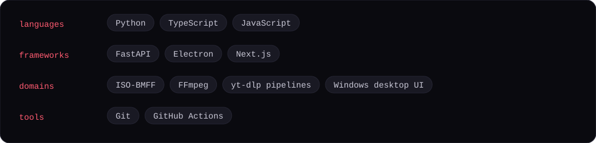

 

I build Windows desktop applications focused on **media processing**, **binary file manipulation**, and **developer utilities** — with an emphasis on performance, lossless workflows, and clean native UI.

 

 

 

 

